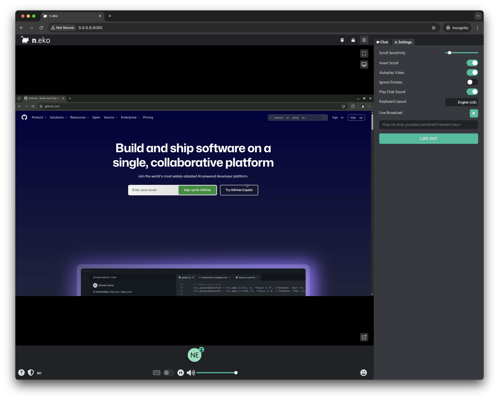

<h1 align=center>Dockette / Neko</h1>

<p align=center>
   <a href="https://github.com/dockette/neko/actions"></a>
   <a href="https://hub.docker.com/r/dockette/neko"></a>
   <a href="https://github.com/sponsors/f3l1x"></a>
   <a href="https://github.com/orgs/dockette/discussions"></a>
</p>

<p align=center>
    🐳 <a href="https://github.com/m1k1o/neko">Neko</a> is a self hosted virtual browser that runs in docker and uses WebRTC.
</p>

<p align=center>
🕹 <a href="https://f3l1x.io">f3l1x.io</a> | 💻 <a href="https://github.com/f3l1x">f3l1x</a> | 🐦 <a href="https://twitter.com/xf3l1x">@xf3l1x</a>
</p>

-----

## Motivation

Forked version supporting Chrome DevTools Protocol.

## Usage

1. Create `docker-compose.yml` file.

Copy [`docker-compose.yml`](./docker-compose.yml) file.

2. Start Docker services.

```
docker compose up
```

3. Open `http://localhost:8080` in your browser. Login `neko` / `admin`.



4. Use Chrome DevTools Protocol on `http://localhost:19222`.

5. Use Playwright MCP on `http://localhost:8931`.

6. Profit.

## Versions

Tags on [Docker Hub](https://hub.docker.com/r/dockette/neko):

- `chromium` - the latest build
- `chromium-YYYY.MM.DD` - the build released on that date (for example `chromium-2026.11.09`)

There is no `latest` tag. Every build is published as a [GitHub release](https://github.com/dockette/neko/releases) named after its date.

The image is built from [`holyfork/m1k1o-neko`](https://github.com/holyfork/m1k1o-neko) commit `7704fcc41399506fe91274b14e6473e100a949e9`, pinned by `NEKO_REF` in [`VERSION`](./VERSION). The fork is based on upstream n.eko `master` after `v3.2.0` (Debian 13 images), plus 9 fork commits (Chrome DevTools Protocol, chrome-mcp and playwright-mcp).

To run a fixed build, set the image in your environment:

```bash
DOCKER_CHROMIUM_IMAGE=dockette/neko:chromium-2026.11.09 docker compose up
```

## Development

CI clones the pinned fork commit, builds the image for `linux/amd64`, smoke tests it and, on `master`, pushes both tags and creates the release.

```bash
make test             # validate docker-compose.yml
make build-chromium   # fetch the pinned NEKO_REF and build the image (slow)
make test-docker      # check that Chromium runs in the image
make run              # start the stack
make version          # print VERSION
make release          # set VERSION to today (UTC)
```

To update Neko, put a new full commit sha into `NEKO_REF` in `VERSION` and run `make release`.

## Maintenance

See [how to contribute](https://github.com/dockette/.github/blob/master/CONTRIBUTING.md) to this package. Consider to [support](https://github.com/sponsors/f3l1x) **f3l1x**. Thank you for using this package.
